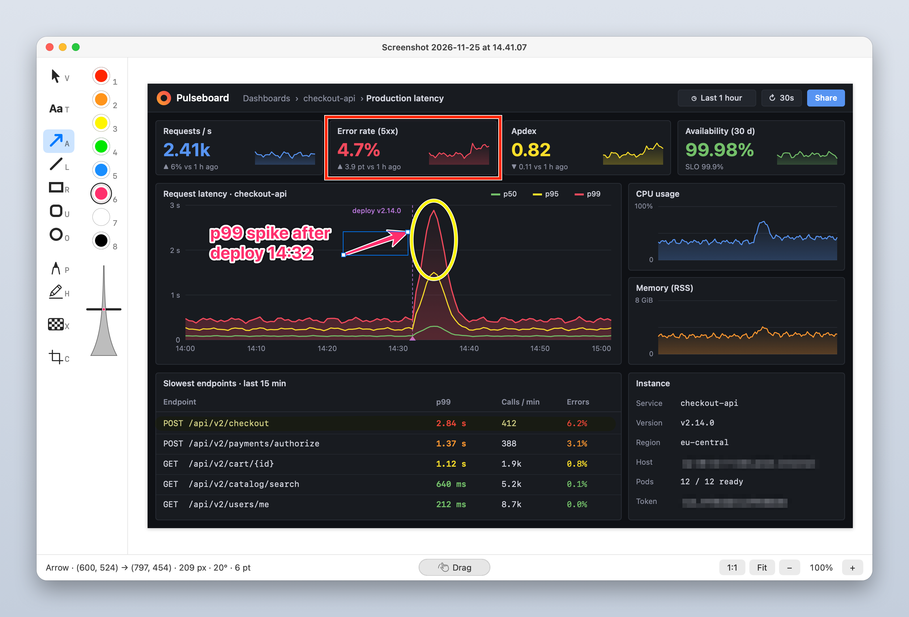

# ySkitch

Fast, keyboard-driven image annotation for macOS. Copy a screenshot, launch, mark it up, copy it back. Native AppKit, no dependencies, no accounts, fully offline.



## Why ySkitch

- **Clipboard-first.** A new window opens with the image already on the clipboard. Annotate, press `⇧⌘C`, paste anywhere.
- **Readable on any background.** Every arrow, shape, line, pen stroke and text gets a Skitch-style double outline: a white inner outline and a soft dark halo.
- **Editable until export.** Annotations stay vector objects: select, move, resize, restyle, copy between windows, undo without limit. The image is flattened only on output.
- **Retina-aware.** A 2× screenshot stays 2× with crisp strokes. Exported PNGs keep the right point size and carry no EXIF/GPS metadata.
- **Everything on the keyboard.** Single-key tools, number keys for colors, `[` `]` for thickness, every command in a menu with its shortcut.
- **What you see is the size you get.** The thickness slider is drawn to true size, with a live sample of the stroke, font or block size.

## Tools

| Tool | Key | What it does |
|---|---|---|
| Select | `V` | Click, `⇧`-click or marquee select; move, resize, drag endpoints |
| Text | `T` | Multiline text; double-click to edit; thickness sets font size |
| Arrow | `A` | Skitch-style tapered arrow; head scales with thickness |
| Line | `L` | Straight segment |
| Rectangle | `R` | Outline |
| Rounded rectangle | `U` | Outline; corner radius scales with thickness |
| Ellipse | `O` | Outline |
| Pen | `P` | Freehand with stroke smoothing |
| Highlighter | `H` | Semi-transparent marker; no darkening where a stroke overlaps itself |
| Pixelate | `X` | Region; original pixels are unrecoverable in the output |
| Crop | `C` | Non-destructive, re-croppable; `↩` applies, `Esc` cancels |

- Fixed 8-color Skitch palette; each tool remembers its own color and thickness.
- Drawing tools edit too: click an annotation to select it, drag it or its handles to change it.
- The canvas grows to fit annotations drawn past the image edge.
- The status bar shows live geometry of the element being drawn or selected (position, size, length, angle, thickness).

## Workflow

1. **In:** launch or `⌘N` to start from the clipboard image; `⌘O` to open a file (PNG, JPEG, HEIC, GIF, TIFF, BMP, WebP); drop an image on the window or the app icon; `⌘V` replaces the current image. `⇧⌘N` opens a blank canvas.
2. **Annotate** with the tools above.
3. **Out:** `⇧⌘C` (or `⌘C` with nothing selected) copies the image; `⌘S` saves a PNG; or drag the **Drag** handle in the status bar into Slack, Mail, Finder.

Closed a window by mistake? `⇧⌘T` brings it back, annotations and undo history included. Closed windows live in memory only and are never written to disk.

## Keyboard shortcuts

| Action | Shortcut |
|---|---|
| Palette color | `1`–`8` |
| Thinner / thicker | `[` / `]` |
| Nudge selection | arrow keys: 1 pt, `⇧` 20 pt |
| Clone and move | `⌘`-drag an annotation |
| Constrain | `⇧`: 45° for lines/arrows, square/circle for shapes, axis lock when moving |
| Reverse arrow | `⌥` while drawing |
| Pan | hold `Space` and move the mouse |
| Zoom in / out | `⌘+` / `⌘-`, `⌘`-scroll, pinch |
| Actual size / fit | `⌘0` / `⌘9` |
| Duplicate / delete | `⌘D` / `⌫` |
| Undo / redo | `⌘Z` / `⇧⌘Z` |
| Copy image / save | `⇧⌘C` / `⌘S` |
| Reopen closed window | `⇧⌘T` |
| Cancel / deselect | `Esc` |

## Build from source

Requirements: macOS 26, Command Line Tools (`xcode-select --install`). Xcode is not needed.

```sh
./build.sh               # release build → build/ySkitch.app (ad-hoc signed)
open build/ySkitch.app
./test.sh                # run the test suite
```

- Swift 6, Swift Package Manager, Apple frameworks only.
- Version lives in `VERSION`; `./version.sh` prints version and build number.
- Full specification: [`docs/requirements.md`](docs/requirements.md).
